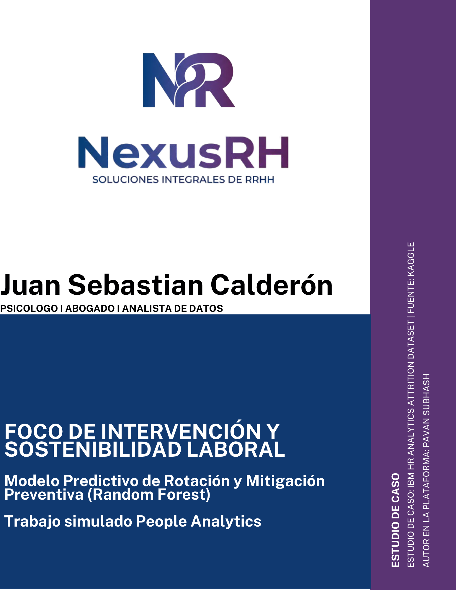

# NexusRH_PeobleAnalytics
Modelo Predictivo de Rotación y Mitigación Preventiva- Random Forest| NexusRH | Trabajo Simulado

- **Autor:** Juan Sebastián Calderón Cardona
- **Perfil:** Psicólogo | Abogado | Analista de Datos
- **Dashboard Interactivo:** [Ver en Tableau Public](https://public.tableau.com/views/NexusIBM/Dashboard1?:language=es-ES&:sid=&:redirect=auth&:display_count=n&:origin=viz_share_link)
- **Documento Técnico Completo:** [Descargar Informe en PDF](NexusRH%20-%20Foco%20de%20intervenci%C3%B3n%20y%20sostenibilidad%20laboral.pdf)
- **Código Fuente:** [Ver Notebook en Python](IBM_art.ipynb)
---

## 1. Justificación y Enfoque Interdisciplinar

Este proyecto constituye un ejercicio analítico y simulado desarrollado a partir del conjunto de datos público sobre deserción laboral de IBM - disponible en Kaggle, compartido por Pavan Subhash.

Su propósito central es superar la administración de recursos humanos basada en la intuición y avanzar hacia un marco de decisión fundamentado en evidencia técnica, integrando tres campos del conocimiento:

* **Psicología Organizacional:** Evaluación del contrato psicológico, el desgaste en el puesto de trabajo y la pérdida de conductas de apoyo voluntario derivadas de la sobrecarga horaria y el rezago salarial.
* **Derecho Laboral Colombiano:** Configuración de la sobrecarga horaria sistemática como causa eficiente del retiro voluntario y análisis de responsabilidad patronal objetiva bajo el estándar del artículo 216 del Código Sustantivo del Trabajo.
* **Ciencia de Datos:** Implementación de modelos supervisados de Machine Learning y técnicas de interpretabilidad algorítmica (SHAP) para detectar alertas tempranas de retiro sin saturar la operación con falsas alarmas.

---

## 2. Diagnóstico Institucional y Metodología

* **Población auditada:** 1,470 colaboradores y 35 variables iniciales; estandarizadas y traducidas al español, confirmando ausencia de nulos y duplicados.
* **Variables descartadas:** Conteo de Empleado, Horas Estándar, Mayor de Edad - varianza cero- e Identificador de Empleado; para evitar memorización.
* **Tasa base histórica de rotación:** 16.12%.
* **Partición de datos:** División estratificada del 80% para entrenamiento y 20% para prueba, aplicando escalamiento estándar ajustado exclusivamente sobre los datos de entrenamiento.

### Evaluación Comparativa de Modelos

| Algoritmo | ROC AUC | Cobertura (Recall) | Precisión | Puntuación F1 | Criterio de Selección |
| :--- | :---: | :---: | :---: | :---: | :--- |
| **Regresión Logística (Weighted)** | 0.7985 | 0.60 | 0.33 | 0.43 | Descartado: Genera 57 falsos positivos, saturando la gestión operativa. |
| **Árbol de Decisión Podado (Prof. 3)** | 0.6990 | 0.64 | 0.32 | 0.43 | Descartado: Baja capacidad de discriminación general. |
| **Bosque Aleatorio (Random Forest, 200 árboles)** | **0.7776** | **0.49** | **0.42** | **0.45** | **Seleccionado:** Mayor equilibrio operativo, reducción de varianza y control de falsas alarmas. |

---

## 3. Jerarquía de Factores y Valores SHAP

El análisis de importancia relativa y la explicabilidad mediante valores SHAP demostraron que la renuncia no responde al azar:

* **Horas Extras:** Es el vector determinante con mayor impacto positivo en la probabilidad de retiro.
* **Años de Experiencia Laboral y Antigüedad:** Los perfiles iniciales con menos trayectoria presentan la mayor vulnerabilidad de deserción ante esquemas de sobretiempo.
* **Nivel de Cargo y Banda Salarial:** Retribuciones por debajo del promedio del sector aceleran el quiebre del contrato psicológico.

---

## 4. Criterios de Riesgo y Medidas de Intervención

A partir de las razones de probabilidades, se establecieron tres umbrales de seguimiento:

* **Riesgo Crítico (Probabilidad >= 70%):** Multiplica la posibilidad relativa de renuncia más de 12 veces frente a la tasa base institucional. Requiere intervención inmediata.
* **Riesgo Medio (Probabilidad entre 40% y 69%):** Incremento de más de 3.5 veces sobre la tasa ordinaria. Alerta preventiva para auditoría de jornadas y revisión salarial.
* **Riesgo Bajo (Probabilidad < 40%):** Rango de estabilidad natural de la plantilla.

En la muestra de validación se identificaron **65 colaboradores activos en riesgo latente**.

### Plan de Intervención Recomendado

* **Control de jornada suplementaria:** Fijación de topes estrictos a las horas extras y redistribución de turnos en áreas críticas para frenar el desgaste acumulado.
* **Nivelación de bandas salariales:** Revisión de remuneraciones en cargos operativos iniciales con menos de dos años y medio de antigüedad.
* **En la practica frente al modelo:** Ejecución mensual del modelo al cierre de cada nómina para actualizar el semáforo de riesgo, acompañada de una recalibración semestral del algoritmo.

---

## 5. Tecnologías y Herramientas

* **Python (Google Colab / Jupyter):** Pandas, NumPy, Scikit-Learn, SHAP, Matplotlib, Seaborn.
* **Tableau Public:** Tablero interactivo con arquitectura responsiva (versión escritorio y móvil sincronizadas).
* **Canva:** Diseño visual y arquitectura de interfaz de reportes ejecutivos.

* * **Nota Académica:** Este proyecto constituye el trabajo final de consolidación práctica para el *Google Advanced Data Analytics Professional Certificate*, aplicando modelamiento predictivo en Python, evaluación de métricas de negocio y visualización ejecutiva en Tableau
